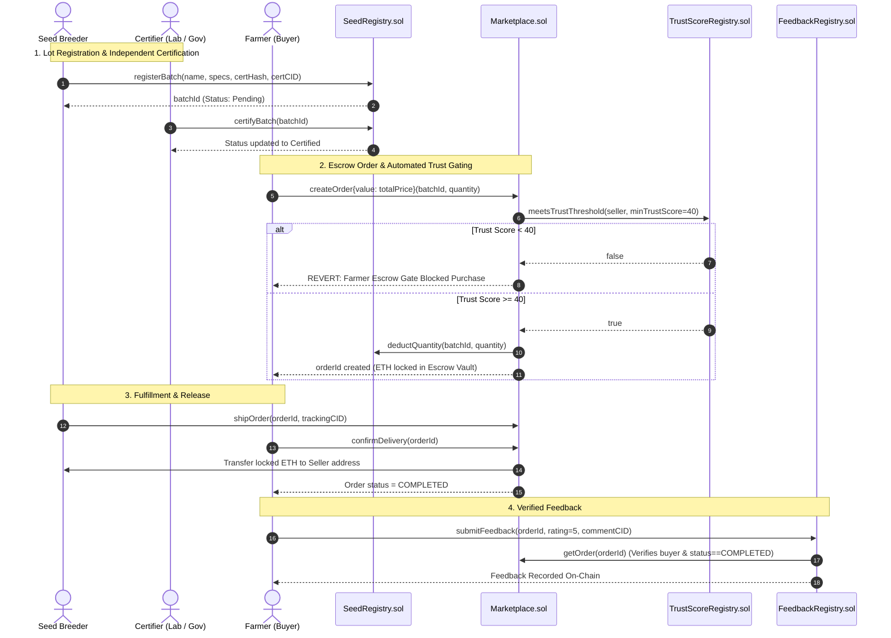

# SeedSure: System Architecture, Blockchain, Backend & Working Specification

> **Document Type:** Technical Architecture, Implementation & Research Specification  
> **Target Audience:** Academic Reviewers, Evaluators, System Architects, Full-Stack Engineers  
> **Platform Version:** 1.0.0 (Research Prototype)  
> **Date:** October 2026  

---

## 1. Executive Summary & Problem Context

### 1.1 The Agricultural Trust Crisis
In global agricultural supply chains—particularly in developing and agrarian economies—counterfeit, adulterated, and sub-standard seed varieties represent an existential threat to food security, crop yield, and farmer livelihoods:
* **The Counterfeit Seed Menace:** Up to 30% of commercial seed packets distributed in regional markets contain adulterated mixtures, non-viable seeds, or unauthorized genetic varieties.
* **Vulnerability of Paper Lab Certificates:** Traditional seed certification relies on paper-based laboratory reports (ICAR, ISTA, or state seed testing bodies) that are easily forged, altered, or duplicated across uncertified batches using photocopiers and digital editing tools.
* **The Post-Harvest Blindspot:** While many enterprise blockchain implementations track "farm-to-fork" traceability after harvest, they fail to safeguard the farmer **at the point of seed purchase**.
* **Farmer Asymmetry & Financial Ruin:** When a farmer purchases unviable seeds, failure is not discovered until 30 to 60 days later when seeds fail to germinate. By then, the capital is lost, planting windows have expired, and recourse is virtually impossible.

### 1.2 The SeedSure Solution
**SeedSure** bridges this critical gap before and during purchase by integrating four interconnected pillars:
1. **AI-Based Visual Seed Quality Assessment:** A Vision Transformer (`ViT-B/16`, 224×224 RGB) classifies optical seed defect distribution across five categories (`Intact`, `Broken`, `Immature`, `Skin-damaged`, `Spotted`) for soybean seed lots, anchored on-chain with IPFS CID and SHA-256 integrity hash.
2. **Cryptographic Proof of Laboratory Quality:** High-resolution seed testing parameters (germination rate, vigor, purity, moisture, disease resistance genes) are bound to a tamper-proof **SHA-256 digital fingerprint** anchored directly onto the Ethereum blockchain, verified by accredited Certification Authorities (CAs).
3. **Dynamic ML-Driven Seller Trust Scoring:** An automated 6-factor dynamic evaluation engine computes dynamic credibility ratings based on actual historical AI visual quality, lab certification ratios, successful deliveries, transaction completion, Bayesian-adjusted reviews, and dispute rates—anchored on-chain via a cryptographic `featuresHash` with an auditable reason log.
4. **Non-Custodial Smart Contract Escrow with Automated Gating:** Buyer payments are locked directly within decentralized Ethereum smart contracts during transit. Funds are only unlocked to the seller when the farmer confirms physical delivery and viability. A built-in **Farmer Safety Gate** programmatically halts checkout if a seller's trust score falls below a verified threshold ($< 40/100$).

---

## 2. Complete System Architecture & Topology

SeedSure employs a **decoupled hybrid Web3 & AI architecture** combining decentralized smart contracts, high-throughput Python machine learning inference, Node.js REST API orchestration, SQLite database caching, and content-addressed IPFS storage:

```
+---------------------------------------------------------------------------------------------------------+
|                                           CLIENT TIER (React SPA)                                       |
|  +--------------------+  +--------------------+  +--------------------+  +---------------------------+  |
|  | Certified Market   |  | Seed Detail Page   |  | Cryptographic      |  | Role Dashboards           |  |
|  | - Realtime Filters |  | - Quality Gauges   |  | Tamper Testbench   |  | - Farmer / Escrow Portal  |  |
|  | - AI Quality Badge |  | - ViT Quality Card |  | - SHA-256 Verifier |  | - Breeder Hub & ViT Upload|  |
|  | - Trust Gate Slider|  | - Full Report Modal|  | - Forgery Simulator|  | - Trust Audit & History   |  |
|  +--------------------+  +--------------------+  +--------------------+  +---------------------------+  |
|                 |                         |                                             |               |
|                 | REST API / JSON         | Re-Hash Document Bytes                      | Web3 Ethers   |
|                 v                         v                                             v               |
+---------------------------------------------------------------------------------------------------------+
|                                    BACKEND & CACHING TIER (Node.js/Express)                             |
|  +---------------------------------------------------------------------------------------------------+  |
|  | RESTful Service Endpoints (/api/seeds, /api/sellers, /api/orders, /api/feedback, /api/ml, /api/trust)|
|  +---------------------------------------------------------------------------------------------------+  |
|  | Multer File Storage & SHA-256 Hashing Engine                                                      |  |
|  +---------------------------------------------------------------------------------------------------+  |
|  | Rebuildable SQLite Database (better-sqlite3 in WAL Mode with Memory Indexes)                       |  |
|  +---------------------------------------------------------------------------------------------------+  |
|  | Blockchain Dual-Mode Service Adapter (Live Hardhat RPC / Anvil JSON-RPC <-> Simulated Ledger)    |  |
|  +---------------------------------------------------------------------------------------------------+  |
|        | (Dual Invocation: HTTP REST or Subprocess CLI Fallback)                                         |
|        v                                                                                                |
|  +---------------------------------------------------------------------------------------------------+  |
|  |                           PYTHON ML INFERENCE SERVICE (/ml_service)                               |  |
|  |  - Vision Transformer (ViT-B/16, 224x224 RGB, ImageNet Normalization)                             |  |
|  |  - 5-Class Categorization: Intact, Broken, Immature, Skin-damaged, Spotted                         |  |
|  |  - Weighted Prototype Visual Quality Score Calculation (0 - 100)                                   |  |
|  |  - Strict Soybean Crop Guard (Unsupported crop prevention)                                        |  |
|  |  - Model Checkpoint: ml_service/models/best_vit.pth (Trained research weights)                   |  |
|  +---------------------------------------------------------------------------------------------------+  |
|        |                                                                                                |
|        | Generates Batch Quality Report & Triggers Trust Sync                                           |
|        v                                                                                                |
|  +---------------------------------------------------------------------------------------------------+  |
|  |                        DYNAMIC SELLER TRUST SCORE ENGINE (6 Factors)                              |  |
|  |  - Historical AI Seed Quality (25%)  |  Certification Verification (20%)                         |  |
|  |  - Successful Delivery Rate (20%)    |  Transaction Performance (15%)                            |  |
|  |  - Farmer Feedback (10%)             |  Complaint & Dispute Health (10%)                          |  |
|  |  - Auditable Reason Generation & Canonical JSON featuresHash SHA-256 Commitment                   |  |
|  +---------------------------------------------------------------------------------------------------+  |
|                                                     | Writes Score + featuresHash + Reason              |
|                                                     v                                                   |
+---------------------------------------------------------------------------------------------------------+
|                                    BLOCKCHAIN & SMART CONTRACT TIER                                     |
|  +---------------------------------------------------------------------------------------------------+  |
|  | EVM Execution Environment (Solidity ^0.8.24 on Ethereum / Hardhat Local / Polygon / Arbitrum)     |  |
|  |                                                                                                   |  |
|  |  +----------------------+  +---------------------+  +------------------------------------------+  |  |
|  |  |  SellerRegistry.sol  |  |   SeedRegistry.sol  |  |         TrustScoreRegistry.sol           |  |  |
|  |  | - Breeder Profiles   |  | - Batch Catalog     |  | - Dynamic 0-100 Trust Ratings            |  |  |
|  |  | - Certifier Vetting  |  | - Lab Quality Specs |  | - updateTrustScoreWithReason()           |  |  |
|  |  | - Fulfillment Stats  |  | - AI Quality Record |  | - Auditable Update History Array         |  |  |
|  |  | - Suspension System  |  | - recordBatchQuality|  | - Immutable featuresHash Audit Vector    |  |  |
|  |  +----------------------+  +---------------------+  +------------------------------------------+  |  |
|  |              |                        |                                  |                        |  |
|  |              +------------------------+-------------+                    | Inter-Contract Query   |  |
|  |                                                     v                    v                        |  |
|  |                                        +---------------------------------------+                  |  |
|  |                                        |            Marketplace.sol            |                  |  |
|  |                                        | - Non-Custodial ETH Escrow Vault      |                  |  |
|  |                                        | - Automated Farmer Protection Gate    |                  |  |
|  |                                        | - Delivery Release & Arbitration      |                  |  |
|  |                                        +---------------------------------------+                  |  |
|  |                                                            ^                                      |  |
|  |                                                            | Validates Buyer & Status             |  |
|  |                                        +---------------------------------------+                  |  |
|  |                                        |          FeedbackRegistry.sol         |                  |  |
|  |                                        | - Sybil-Resistant Verified Reviews    |                  |  |
|  |                                        | - Strict Completed-Order Check        |                  |  |
|  |                                        +---------------------------------------+                  |  |
|  +---------------------------------------------------------------------------------------------------+  |
|                                                     |                                                   |
|                                                     | Storage CIDs                                      |
|                                                     v                                                   |
|  +---------------------------------------------------------------------------------------------------+  |
|  |                     DECENTRALIZED STORAGE TIER (IPFS / Content Addressable)                       |  |
|  |  - Seed Photographs  |  AI Batch Quality Reports  |  Lab Certificates  |  Accreditation Papers    |  |
|  +---------------------------------------------------------------------------------------------------+  |
+---------------------------------------------------------------------------------------------------------+
```

---

## 3. Blockchain Architecture & Smart Contract Suite

### 3.1 Technology Stack & Strategic Rationales

| Technology | Role | Why It Is Used & Strategic Justification |
| :--- | :--- | :--- |
| **Solidity (^0.8.24)** | Core Smart Contract Language | The industry standard for EVM programming. Compiler version 0.8.24 includes native checked arithmetic (built-in overflow/underflow protection preventing integer vulnerabilities) and transient storage support (`TSTORE`/`TLOAD`). |
| **OpenZeppelin Contracts v5** | Security & Access Control Primitives | Provides rigorously audited implementations of `AccessControl` and `ReentrancyGuard`. `AccessControl` grants granular role-based permissions (`DEFAULT_ADMIN_ROLE`, `CERTIFIER_ROLE`, `MARKETPLACE_ROLE`, `ORACLE_ROLE`), eliminating single-key vulnerabilities. `ReentrancyGuard` protects escrow fund releases against reentrancy attacks. |
| **Hardhat Toolchain** | Development, Testing & Compilation | Local EVM simulation environment with automated test runner. Enables full in-process Solidity contract testing, gas estimation, deterministic contract deployment, and TypeScript type binding generation. |
| **Ethers.js (v6)** | Web3 RPC & Contract Interaction | Lightweight, modern JavaScript library with complete contract typing, event streaming, BigNumber handling, cryptographic utility functions (`keccak256`, `sha256`), and JSON-RPC network interaction. |
| **IPFS (InterPlanetary File System)** | Decentralized File Storage | Storing large PDF lab test certificates directly on Ethereum is economically infeasible (storing 1 MB on-chain costs over \$20,000 in gas). IPFS provides content-addressed, immutable storage where files are indexed by cryptographic CIDs (`Qm...`). Smart contracts only store the 32-byte SHA-256 hash and CID. |

---

### 3.2 Deep Dive: The 5 Smart Contracts

#### Contract 1: `SellerRegistry.sol`
* **Purpose:** Acts as the decentralized identity and accreditation repository for all seed breeders and distribution companies.
* **Roles:**
  * `DEFAULT_ADMIN_ROLE`: High-level governance, can assign roles and suspend fraudulent actors.
  * `CERTIFIER_ROLE`: Official agricultural certification agencies (e.g., ICAR/State Seed Agencies) that audit seller physical licenses.
  * `MARKETPLACE_ROLE`: Granted to `Marketplace.sol` to allow automated updating of transaction metrics upon order events.
* **Key State Struct:**
  ```solidity
  struct Seller {
      address sellerAddress;
      string metadataCID;        // IPFS link to official company licensing papers
      bool isVerified;           // Granted only by an accredited CERTIFIER_ROLE
      bool isSuspended;          // Platform admin killswitch for malicious actors
      uint256 totalOrders;       // Lifetime order count
      uint256 successfulOrders;  // Completed orders without unresolved disputes
      uint256 failedOrders;      // Orders where seller was ruled at fault
      uint256 deliveredOrders;   // Successfully delivered orders
      uint256 delayedOrders;     // Orders exceeding agreed delivery windows
      uint256 disputedOrders;    // Total disputes initiated against seller
      uint256 disputesLost;      // Disputes arbitrated in buyer's favor
      uint256 registeredAt;      // Block timestamp of seller onboarding
  }
  ```
* **Critical Methods:**
  * `registerSeller(string metadataCID)`: Anyone can register their address as a prospective seed breeder.
  * `verifySeller(address seller)`: Only addresses with `CERTIFIER_ROLE` can mark a breeder as officially vetted.
  * `suspendSeller(address seller)`: Emergency deactivation of seller rights.
  * `recordOrderPlaced`, `recordOrderDelivered`, `recordOrderDisputed`, `recordDisputeResolved`: Programmatically invoked by `Marketplace.sol` to maintain an immutable performance ledger without off-chain tampering.

---

#### Contract 2: `SeedRegistry.sol`
* **Purpose:** Represents the immutable catalog of agricultural seed lots. Each lot has specific genetic, physical, and biochemical quality metrics tied to an accredited laboratory certificate.
* **Key State Structs:**
  ```solidity
  struct Batch {
      uint256 batchId;
      address seller;
      string name;
      string cropType;
      string variety;
      string batchNumber;
      uint16 germinationRate;    // Fixed-point: 945 = 94.5%
      uint16 purity;             // Fixed-point: 980 = 98.0%
      uint16 vigor;              // Standard vigor index: 920 = 92.0%
      uint16 moisture;           // Moisture content: 105 = 10.5%
      uint256 pricePerKg;        // Price in wei per kilogram
      uint256 availableQuantity; // Current stock inventory
      uint8 status;              // 0 = Pending, 1 = Certified, 2 = Revoked
      bytes32 certificateHash;   // SHA-256 hash of official lab certificate PDF
      string certificateCID;     // IPFS content address
  }
  ```
* **Extended Audit Struct:**
  ```solidity
  struct BatchMetadata {
      string manufacturer;
      string diseaseResistance;  // Known genetic resistance markers (e.g. Yr9, Lr24)
      uint256 expiryDate;        // Epoch timestamp after which viability degrades
      string metadataCID;
      uint256 registeredAt;
      address certifiedBy;       // Public key of verifying lab certifier
      uint256 certifiedAt;
      string revocationReason;   // Documented reason if batch fails post-market spot checks
  }
  ```
* **Core Mechanisms:**
  * **Duplicate Registration Guard:** Prevents the same lab certificate from being recycled across multiple batches:
    `require(!_registeredHashes[certificateHash], "Certificate hash already registered");`
  * **Certification Lifecycle:**
    $$\text{Pending (0)} \xrightarrow{\text{certifyBatch() by CERTIFIER}} \text{Certified (1)} \xrightarrow{\text{revokeBatch()}} \text{Revoked (2)}$$
  * **AI Visual Seed Quality Assessment Oracle Record:**
    ```solidity
    struct AIQualityRecord {
        uint256 batchId;
        uint256 visualQualityScore; // 0 - 100
        string qualityCategory;     // "Excellent" | "Good" | "Moderate" | "Poor" | "Very Poor"
        string reportCID;           // IPFS CID to full JSON assessment report
        bytes32 reportHash;         // SHA-256 integrity hash of report
        string modelVersion;        // "SeedSure-ViT-B16-v1.0"
        uint256 timestamp;
        address assessedBy;
    }
    ```
    Oracle nodes invoke `recordBatchQualityAssessment()` to anchor the ViT inference result directly to the batch on-chain.
  * **Inventory Deduction:** `deductQuantity(uint256 batchId, uint256 quantity)` can only be called by the `MARKETPLACE_ROLE` during valid escrow order creation.
  * **On-Chain Tamper Verification Testbench:** `verifyBatch(batchId, testHash)` returns `(bool isValid, bool isCertified)` by checking if `testHash == b.certificateHash`.

---

#### Contract 3: `TrustScoreRegistry.sol`
* **Purpose:** Decentralized oracle contract that records ML-computed seller trust ratings and anchors cryptographic audit vectors.
* **Key State Structs:**
  ```solidity
  struct ScoreRecord {
      uint8 score;               // Trust rating bounded [0, 100]
      string riskCategory;       // "Excellent" | "Trusted" | "Moderate" | "Low" | "High Risk"
      uint256 updatedAt;         // Block timestamp of score generation
      string modelVersion;       // Exact model algorithm (e.g. "SeedSure-ML-v1.4")
      bytes32 featuresHash;      // SHA-256 hash of canonical multi-factor vector
  }

  struct TrustUpdateAudit {
      uint256 previousScore;
      uint256 newScore;
      bytes32 featuresHash;
      string reason;             // Human-readable trigger explanation
      uint256 timestamp;
      address updatedBy;
  }
  ```

* **Auditable Reason History:**
  `updateTrustScoreWithReason(seller, score, featuresHash, reason)` records an immutable chronological history entry accessible through `getTrustScoreHistoryItem(seller, index)`. Every score change is auditable on-chain.

* **Why `featuresHash` is a Breakthrough for Blockchain-ML Integration:**
  Most blockchain oracles act as "black boxes" that post arbitrary numbers. In SeedSure, the oracle is forced to publish `featuresHash = SHA256(canonicalJSON(features))`. Any auditor or researcher can recompute the hash from raw transaction history and verify that the ML model calculated the score fairly without bias or bribes.
* **Threshold Gating Function:**
  ```solidity
  function meetsTrustThreshold(address seller, uint8 minScore) external view returns (bool) {
      if (!_hasScore[seller]) {
          return 50 >= minScore; // Default baseline for new sellers
      }
      return _scores[seller].score >= minScore;
  }
  ```

---

#### Contract 4: `Marketplace.sol` (Non-Custodial Escrow Vault)
* **Purpose:** Facilitates trustless agricultural seed purchases by holding farmer funds in escrow until physical receipt and seed quality validation.
* **Escrow State Machine:**
  $$\text{ESCROWED (0)} \xrightarrow{\text{shipOrder()}} \text{SHIPPED (1)} \xrightarrow{\text{confirmDelivery()}} \text{COMPLETED (2)}$$
  $$\text{ESCROWED / SHIPPED} \xrightarrow{\text{disputeOrder()}} \text{DISPUTED (3)} \xrightarrow{\text{resolveDispute()}} \begin{cases} \text{REFUNDED (4)} \\ \text{COMPLETED (2)} \\ \text{SPLIT (50/50)} \end{cases}$$
* **The Automated Farmer Protection Gate:**
  Before locking funds or creating an order, `createOrder` queries `TrustScoreRegistry`:
  ```solidity
  require(
      trustScoreRegistry.meetsTrustThreshold(batch.seller, minTrustScore),
      "Seller trust score below safety threshold. Farmer escrow gate blocked purchase."
  );
  ```
  If a rogue seller with a score $< 40$ attempts to sell, the transaction reverts at the EVM execution level.
* **Reentrancy Protection & Fund Segregation:**
  The contract inherits `ReentrancyGuard`. In `confirmDelivery`, state transition occurs **before** external transfer (Checks-Effects-Interactions pattern):
  ```solidity
  order.status = OrderStatus.COMPLETED;
  order.completedAt = block.timestamp;
  sellerRegistry.recordOrderDelivered(order.seller, true);
  uint256 amount = order.totalPrice;
  (bool sent, ) = payable(order.seller).call{value: amount}("");
  require(sent, "Failed to release escrow payment to seller");
  ```

---

#### Contract 5: `FeedbackRegistry.sol`
* **Purpose:** Solves the pervasive Web2 issue of fake review inflation and competitor sabotage in agricultural e-commerce.
* **Sybil-Resistance Rule:**
  Feedback can only be submitted if the caller is the registered buyer of an order that has reached the `COMPLETED` state in `Marketplace.sol`:
  ```solidity
  IMarketplace.Order memory order = marketplace.getOrder(orderId);
  require(order.buyer == msg.sender, "Only the verified order buyer can review");
  require(order.status == 2, "Order must be COMPLETED to submit review");
  require(!_hasFeedback[orderId], "Feedback already submitted for this order");
  ```
* Ratings are strictly integer values from $1$ to $5$ stars, and feedback commentary is stored on IPFS (`commentCID`).

---

### 3.3 Smart Contract Interaction Sequence Diagram



---

## 4. Backend Architecture & High-Performance Cache Layer

### 4.1 Technology Stack & Strategic Rationales

| Technology | Role | Why It Is Used & Strategic Justification |
| :--- | :--- | :--- |
| **Node.js + Express** | High-Performance REST API Framework | Non-blocking I/O event loop is ideal for concurrent web traffic and asynchronous smart contract event synchronization. |
| **TypeScript** | Static Typing & Contract Interface Binding | Eliminates runtime type bugs across financial calculations, matches Solidity struct definitions identically, and ensures clean contract ABI consumption. |
| **better-sqlite3** | Embedded Rebuildable Relational Cache | SQLite running in WAL (Write-Ahead Logging) mode executes queries synchronously in C++ within the Node process, delivering sub-millisecond lookups ($< 0.5\text{ ms}$). If the database is ever lost, it can be 100% reconstructed from on-chain event logs. |
| **Multer** | Multipart Form & Document Ingestion | Processes file uploads (seed lab certificates, dispute evidence photos, waybills) directly into local cache and automatically generates SHA-256 hashes. |
| **Dual-Mode Adapter** | High Availability Architecture | Automatically connects to a live Ethereum node (Hardhat/Anvil/Sepolia) when available, while providing seamless in-memory fallback for offline demonstrations or Netlify deployments. |

---

### 4.2 Database Schema (Data Dictionary)

The backend maintains 6 normalized tables optimized with B-tree indices for instant queries, search, and analytics:

```sql
-- 1. SELLERS TABLE: Mirrored profile, verification & performance metrics
CREATE TABLE sellers (
  address TEXT PRIMARY KEY,
  name TEXT NOT NULL,
  description TEXT,
  location TEXT,
  metadataCID TEXT,
  isVerified INTEGER DEFAULT 0,
  isSuspended INTEGER DEFAULT 0,
  trustScore INTEGER DEFAULT 50,
  riskCategory TEXT DEFAULT 'Moderate',
  totalOrders INTEGER DEFAULT 0,
  successfulOrders INTEGER DEFAULT 0,
  failedOrders INTEGER DEFAULT 0,
  deliveredOrders INTEGER DEFAULT 0,
  delayedOrders INTEGER DEFAULT 0,
  disputedOrders INTEGER DEFAULT 0,
  disputesLost INTEGER DEFAULT 0,
  certifiedBatchesCount INTEGER DEFAULT 0,
  totalBatchesCount INTEGER DEFAULT 0,
  avgFarmerRating REAL DEFAULT 4.0,
  ratingCount INTEGER DEFAULT 0,
  registeredAt TEXT NOT NULL,
  updatedAt TEXT NOT NULL
);

-- 2. SEEDS TABLE: Quality parameters, certification state & cryptographic hashes
CREATE TABLE seeds (
  id INTEGER PRIMARY KEY AUTOINCREMENT,
  sellerAddress TEXT NOT NULL,
  name TEXT NOT NULL,
  cropType TEXT NOT NULL,
  variety TEXT NOT NULL,
  batchNumber TEXT UNIQUE NOT NULL,
  manufacturer TEXT NOT NULL,
  germinationRate REAL NOT NULL,
  purity REAL NOT NULL,
  vigor REAL NOT NULL,
  moisture REAL NOT NULL,
  diseaseResistance TEXT NOT NULL,
  harvestDate TEXT NOT NULL,
  expiryDate TEXT NOT NULL,
  pricePerKg REAL NOT NULL,
  availableQuantityKg REAL NOT NULL,
  metadataCID TEXT NOT NULL,
  certificateCID TEXT NOT NULL,
  certificateHash TEXT NOT NULL,
  certificationStatus TEXT DEFAULT 'Certified',
  certifiedBy TEXT,
  certifiedAt TEXT,
  isDemo INTEGER DEFAULT 1,
  createdAt TEXT NOT NULL,
  FOREIGN KEY (sellerAddress) REFERENCES sellers(address)
);

-- 3. ORDERS TABLE: Escrow financial state and courier tracking
CREATE TABLE orders (
  id INTEGER PRIMARY KEY AUTOINCREMENT,
  batchId INTEGER NOT NULL,
  buyerAddress TEXT NOT NULL,
  sellerAddress TEXT NOT NULL,
  quantityKg REAL NOT NULL,
  totalPriceEth REAL NOT NULL,
  status TEXT NOT NULL, -- 'CREATED', 'ESCROWED', 'SHIPPED', 'DELIVERED', 'COMPLETED', 'DISPUTED', 'REFUNDED'
  escrowLocked INTEGER DEFAULT 1,
  escrowReleased INTEGER DEFAULT 0,
  trackingNumber TEXT,
  carrierName TEXT,
  shippedAt TEXT,
  deliveredAt TEXT,
  completedAt TEXT,
  createdAt TEXT NOT NULL,
  FOREIGN KEY (batchId) REFERENCES seeds(id)
);

-- 4. FEEDBACK TABLE: Farmer reviews tied to verified orders
CREATE TABLE feedback (
  id INTEGER PRIMARY KEY AUTOINCREMENT,
  orderId INTEGER UNIQUE NOT NULL,
  batchId INTEGER NOT NULL,
  sellerAddress TEXT NOT NULL,
  buyerAddress TEXT NOT NULL,
  rating INTEGER NOT NULL, -- 1 to 5
  comment TEXT,
  commentCID TEXT,
  createdAt TEXT NOT NULL,
  FOREIGN KEY (orderId) REFERENCES orders(id)
);

-- 5. DISPUTES TABLE: Formal arbitration records and evidence
CREATE TABLE disputes (
  id INTEGER PRIMARY KEY AUTOINCREMENT,
  orderId INTEGER UNIQUE NOT NULL,
  buyerAddress TEXT NOT NULL,
  sellerAddress TEXT NOT NULL,
  reason TEXT NOT NULL,
  evidenceCID TEXT,
  evidenceHash TEXT,
  status TEXT DEFAULT 'OPEN', -- 'OPEN', 'REFUNDED', 'RELEASED_TO_SELLER', 'SPLIT'
  resolutionNotes TEXT,
  resolvedAt TEXT,
  createdAt TEXT NOT NULL,
  FOREIGN KEY (orderId) REFERENCES orders(id)
);

-- 6. TRUST SCORE HISTORY TABLE: Complete cryptographic audit trail
CREATE TABLE trust_score_history (
  id INTEGER PRIMARY KEY AUTOINCREMENT,
  sellerAddress TEXT NOT NULL,
  score INTEGER NOT NULL,
  riskCategory TEXT NOT NULL,
  modelVersion TEXT NOT NULL,
  featuresHash TEXT NOT NULL,
  featuresJson TEXT NOT NULL,
  triggerEvent TEXT NOT NULL,
  createdAt TEXT NOT NULL
);

-- 7. SEED QUALITY REPORTS TABLE: ViT inference results and 5-class distribution
CREATE TABLE seed_quality_reports (
  id INTEGER PRIMARY KEY AUTOINCREMENT,
  batchId TEXT UNIQUE NOT NULL,
  sellerAddress TEXT NOT NULL,
  cropType TEXT NOT NULL,
  variety TEXT,
  visualQualityScore REAL NOT NULL,
  qualityCategory TEXT NOT NULL,
  totalImagesAnalyzed INTEGER NOT NULL,
  classDistributionJson TEXT NOT NULL,
  predictionsJson TEXT NOT NULL,
  reportCID TEXT,
  reportHash TEXT,
  modelVersion TEXT NOT NULL,
  assessedAt TEXT NOT NULL,
  createdAt TEXT NOT NULL
);
```

---

### 4.3 REST API Endpoints Catalog

The backend exposes a comprehensive set of RESTful endpoints grouped into 8 functional domains:

| Category | Method & Path | Description |
| :--- | :--- | :--- |
| **AI Seed Quality (ViT)** | `POST /api/ml/seed/analyze` | Ingests batch photos, runs ViT-B/16 inference, calculates score, and syncs trust. |
| | `GET /api/ml/seed/result/:batchId` | Retrieves stored batch visual quality report and defect breakdown. |
| | `GET /api/ml/seed/health` | Checks ML service and model checkpoint readiness. |
| **Dynamic Seller Trust** | `POST /api/trust/recalculate/:sellerId` | Recomputes 6-factor trust score with auditable trigger reason. |
| | `GET /api/trust/:sellerId` | Returns current trust score, trust category, coverage %, and confidence. |
| | `GET /api/trust/:sellerId/history` | Chronological audit history of trust updates with reasons and block links. |
| | `GET /api/trust/:sellerId/breakdown` | Parameter-wise breakdown and actionable improvement recommendations. |
| **Seed Catalog** | `GET /api/seeds` | Query seeds with search filters (`q`, `category`, `minTrust`, `certifiedOnly`, `sort`). |
| | `GET /api/seeds/:id` | Fetch full seed batch details including laboratory specifications. |
| | `POST /api/seeds` | Register a newly harvested seed lot (computes `certificateHash`). |
| | `POST /api/seeds/:id/certify` | CA approval of seed lot after lab verification. |
| | `POST /api/seeds/:id/revoke` | CA revocation of certified status due to adulteration. |
| **Breeder / Seller** | `GET /api/sellers` | Retrieve list of all breeders and current trust scores. |
| | `GET /api/sellers/:address` | Fetch specific seller profile, metrics, and score breakdown. |
| | `POST /api/sellers/register` | Register new breeder profile and metadata CID. |
| | `POST /api/sellers/:address/verify` | CA certification of breeder license credentials. |
| | `POST /api/sellers/:address/suspend` | Governance suspension of fraudulent seller. |
| **Escrow Orders** | `GET /api/orders` | Fetch orders filtered by `buyer`, `seller`, or `status`. |
| | `POST /api/orders` | Initiate escrow purchase (validates trust threshold gating). |
| | `POST /api/orders/:id/ship` | Seller inputs shipment dispatch and tracking information. |
| | `POST /api/orders/:id/confirm-delivery` | Buyer confirms delivery; unlocks escrow payment to seller. |
| | `POST /api/orders/:id/dispute` | Buyer raises dispute (non-germination, adulteration). |
| | `POST /api/orders/:id/resolve-dispute` | Arbiter resolves dispute (`REFUND`, `RELEASE_TO_SELLER`, `SPLIT`). |
| **Feedback** | `POST /api/feedback` | Verified buyer submits 1-5 star review for completed order. |
| **Storage & Tamper** | `POST /api/ipfs/upload` | Multipart upload for certificates/evidence; returns CID and SHA-256. |
| | `POST /api/ipfs/verify-tamper` | Recomputes SHA-256 of file and checks against recorded hash. |
| **Explorer & Stats** | `GET /api/blockchain/status` | Real-time block height, gas price, network, and contract addresses. |
| | `GET /api/blockchain/transactions`| Live transaction ledger for all on-chain actions. |
| | `POST /api/blockchain/verify-batch`| Directly verifies a batch against smart contract storage. |
| | `GET /api/analytics` | High-level metrics: total volume, certified batches, trust distribution. |

---

## 5. Machine Learning Assessment Systems: Seed Quality & Seller Trust

SeedSure implements two interconnected but fundamentally separate assessment systems:
1. **AI-Based Visual Seed Quality Assessment:** Batch-level Vision Transformer (ViT-B/16) model evaluating physical seed coat integrity and defect distribution.
2. **Dynamic Seller Trust Score Engine:** Seller-level 6-factor multi-parameter reliability engine evaluating historical performance across transactions, certifications, deliveries, and farmer ratings.

---

### 5.1 Vision Transformer (ViT-B/16) Seed Quality Assessment

#### 5.1.1 Model Architecture & Preprocessing (`according_to_rsp_(1).ipynb`)
- **Base Architecture**: `torchvision.models.vit_b_16(weights=ViT_B_16_Weights.DEFAULT)`
- **Classification Head**:
  $$\text{Dropout}(0.5) \to \text{Linear}(768 \to 256) \to \text{ReLU} \to \text{Dropout}(0.3) \to \text{Linear}(256 \to 5)$$
- **Input Resolution**: $224 \times 224$ pixels, RGB format.
- **ImageNet Normalization**:
  - Mean: $[0.485, 0.456, 0.406]$
  - Standard Deviation: $[0.229, 0.224, 0.225]$
- **Model Checkpoint**: `ml_service/models/best_vit.pth`

#### 5.1.2 Five Defect Classes & Prototype Scoring Formula
The model classifies uploaded soybean photographs across 5 categories:
1. `Intact` (Weight: 100)
2. `Immature` (Weight: 55)
3. `Spotted` (Weight: 40)
4. `Skin-damaged` (Weight: 35)
5. `Broken` (Weight: 10)

$$\text{AI Visual Seed Quality Score} = \frac{P_{\text{Intact}} \times 100 + P_{\text{Immature}} \times 55 + P_{\text{Spotted}} \times 40 + P_{\text{Skin-damaged}} \times 35 + P_{\text{Broken}} \times 10}{100}$$

#### 5.1.3 Quality Categories
| Score | Category | Market Determination |
| :---: | :--- | :--- |
| **90–100** | **Excellent** | Premium physical grade |
| **75–89** | **Good** | Standard commercial grade |
| **60–74** | **Moderate** | Acceptable with caution |
| **40–59** | **Poor** | Substandard defect ratio |
| **0–39** | **Very Poor** | Defective / high breakage |

#### 5.1.4 Strict Crop Restriction & Viability Disclaimer
- **Crop Guard**: ViT inference is calibrated and active strictly for **Soybean**. Unsupported crops return an informative notice and rely on laboratory certifications.
- **Mandatory Viability Disclaimer**: AI Visual Seed Quality Score evaluates optical surface integrity and physical defect distribution. It does **not** evaluate or guarantee physiological germination viability, emergence vigor, internal moisture content, or genetic purity.

---

### 5.2 Dynamic Seller Trust Score Engine

The Seller Trust Score ($0 - 100$) dynamically tracks breeder reliability across multiple completed lifecycle events:

$$\text{Seller Trust Score} = 0.25 \cdot S_{\text{quality}} + 0.20 \cdot S_{\text{cert}} + 0.20 \cdot S_{\text{delivery}} + 0.15 \cdot S_{\text{tx}} + 0.10 \cdot S_{\text{feedback}} + 0.10 \cdot S_{\text{complaints}}$$

```
+--------------------------------------------------------------------------------------------------------+
|                                  6-FACTOR TRUST SCORE WEIGHT ALLOCATION                                |
|                                                                                                        |
|   [================= 25% =================]  Historical AI Seed Quality (Squality)                   |
|   [============= 20% =============]          Certification Verification Ratio (Scert)                  |
|   [============= 20% =============]          Successful Delivery Rate (Sdelivery)                      |
|   [========== 15% ==========]                Transaction Performance (Stx)                             |
|   [====== 10% ======]                        Farmer Feedback Rating (Sfeedback)                        |
|   [====== 10% ======]                        Complaint & Dispute Health (Scomplaints)                  |
+--------------------------------------------------------------------------------------------------------+
```

#### Factor Breakdown:
1. **Historical AI Seed Quality ($S_{\text{quality}}$, Weight: 25%):**
   Mean AI Visual Quality Score across all assessed batches:
   $$S_{\text{quality}} = \frac{1}{N} \sum_{i=1}^{N} \text{VisualQualityScore}_i$$
2. **Certification Verification Ratio ($S_{\text{cert}}$, Weight: 20%):**
   Ratio of certified batches to total registered lots:
   $$S_{\text{cert}} = \left( \frac{\text{Certified Batches Count}}{\text{Total Batches Count}} \right) \times 100$$
3. **Successful Delivery Rate ($S_{\text{delivery}}$, Weight: 20%):**
   Penalizes delayed shipments:
   $$S_{\text{delivery}} = \max\left(0, \frac{\text{Delivered Orders} - 0.5 \times \text{Delayed Orders}}{\text{Total Orders}}\right) \times 100$$
4. **Transaction Performance ($S_{\text{tx}}$, Weight: 15%):**
   Percentage of orders fulfilled without failure:
   $$S_{\text{tx}} = \left( \frac{\text{Successful Orders}}{\text{Total Orders}} \right) \times 100$$
5. **Farmer Feedback ($S_{\text{feedback}}$, Weight: 10%):**
   Empirical Bayesian prior ($\mu = 3.5, k = 3$) for verified escrow order reviews:
   $$R_{\text{Bayes}} = \frac{R_{\text{avg}} \times n + 3.5 \times 3}{n + 3}, \quad S_{\text{feedback}} = \left( \frac{R_{\text{Bayes}} - 1}{4} \right) \times 100$$
6. **Complaint & Dispute Health ($S_{\text{complaints}}$, Weight: 10%):**
   Dispute avoidance index:
   $$S_{\text{complaints}} = \max\left(0, 100 - \frac{2.0 \times \text{Disputes Lost} + 0.5 \times \text{Disputed Orders}}{\text{Total Orders}} \times 100\right)$$

#### Fairness & Integrity Rules:
1. Missing data is never treated as a score of 100.
2. New sellers receive **"New Seller – Insufficient Data"** status and Low confidence until evidence threshold ($N \ge 3$ batches, $M \ge 2$ orders) is met.
3. Every score update records an auditable timestamped reason on blockchain and database.

### 5.3 Risk Categorization & Farmer Protection Matrix

| Trust Score Range | Risk Category | Color Indicator | Escrow Action | Status Meaning |
| :---: | :---: | :---: | :---: | :--- |
| **85 – 100** | **Excellent** | Vibrant Emerald | Instant Purchase Allowed | Highly vetted breeder, exceptional lab testing, flawless on-time delivery record. |
| **70 – 84** | **Trusted** | Forest Green | Instant Purchase Allowed | Reliable commercial breeder with consistent germination ratings. |
| **55 – 69** | **Moderate** | Amber / Yellow | Purchase Allowed with Advisory | New seller with limited history or minor fulfillment delays. |
| **40 – 54** | **Low** | Orange | Purchase Allowed with Warning | High proportion of uncertified lots or past dispute complaints. |
| **0 – 39** | **High Risk** | Crimson Red | **BLOCKED BY ESCROW GATE** | Suspended, uncertified, or dispute-ridden seller. Contract reverts transaction automatically. |

---

## 6. Cryptographic Tamper-Proof Verification Pipeline

### 6.1 The Mechanics of Seed Certificate Forgery
In traditional agriculture, a seed broker obtains a genuine lab test report for a high-quality seed lot (e.g., $95\%$ germination, $99\%$ purity). The broker scans the PDF, uses digital editing software to alter the batch number and expiration date, and attaches the forged document to bags of low-quality or expired seeds.

### 6.2 The SeedSure Cryptographic Defense
SeedSure eliminates this vulnerability through a deterministic **SHA-256 cryptographic digest**:

```
+---------------------------------------------------------------------------------------------------------+
|                                    CRYPTOGRAPHIC TAMPER VERIFICATION PIPELINE                           |
|                                                                                                         |
|  [ Original Lab Certificate PDF ]                                                                       |
|                 |                                                                                       |
|                 v SHA-256 Hash Function (Avalanche Effect)                                              |
|  0x4a7e91f0c2bd18a93ef07a9b83b49f82631a9ef27f8045618cdb3974d6423a10                                      |
|                 |                                                                                       |
|                 +----------------------------+                                                          |
|                 | Committed at Registration  | Stored in Distributed Network                            |
|                 v                            v                                                          |
|    +--------------------------+    +--------------------------+                                         |
|    |  Ethereum Smart Contract |    |    IPFS / Storage Node   |                                         |
|    |     SeedRegistry.sol     |    |       CID: QmX89...      |                                         |
|    +--------------------------+    +--------------------------+                                         |
|                 |                            |                                                          |
|                 | Immutable On-Chain Hash    | Downloads Raw Bytes                                      |
|                 v                            v                                                          |
|    +----------------------------------------------------------+                                         |
|    |           Client Browser (Web Crypto API)                |                                         |
|    |      Re-hashes File Bytes: crypto.subtle.digest()        |                                         |
|    +----------------------------------------------------------+                                         |
|                 |                                                                                       |
|                 v Bitwise Comparison                                                                    |
|    +----------------------------------------------------------+                                         |
|    | If Recomputed Hash == On-Chain Hash -> PASS (Authentic)  |                                         |
|    | If Single Byte Altered              -> FAIL (FORGERY)    |                                         |
|    +----------------------------------------------------------+                                         |
+---------------------------------------------------------------------------------------------------------+
```

1. **Lot Registration:** The seed lab analyzes the batch and generates the official lab certificate PDF. The client or backend computes its SHA-256 hash:
   $$\text{certificateHash} = \text{SHA256}(\text{document bytes})$$
2. **On-Chain Commitment:** The seller submits `certificateHash` to `SeedRegistry.registerBatch()`. Once mined, this 32-byte hash is **permanent, tamper-proof, and universally verifiable**.
3. **CA Signature:** An accredited testing agency calls `certifyBatch()`, affirming that the laboratory credentials matching that hash are valid.
4. **Client-Side Verification:** When a farmer scans the QR code on a physical seed bag or views the certificate on the marketplace, the client application downloads the PDF and re-hashes it locally using the browser's native `crypto.subtle.digest("SHA-256", rawBytes)`.
5. **Detection of Adversarial Forgery:** Due to the **Avalanche Effect** of cryptographic hashing, altering even a single period or character in the PDF changes over $50\%$ of the resulting hash bits. The comparison fails instantly, displaying a high-contrast **FORGERY DETECTED** warning to the farmer.

---

## 7. Comparative Technology Evaluation Matrix ("What is Used and Why")

| System Component | Technology Chosen | Alternatives Evaluated | Decisive Technical Rationale |
| :--- | :--- | :--- | :--- |
| **Escrow Vault & Settlement** | Solidity Smart Contracts on Ethereum EVM | Centralized Payment Gateways (Stripe, Razorpay) / Escrow Agents | Centralized gateways can freeze agricultural funds arbitrarily, charge high percentages ($2.9\%+$), and rely on subjective manual dispute personnel. Smart contracts provide trustless, non-custodial custody where code is law. |
| **Trust Score Auditability** | Canonical JSON `featuresHash` committed on-chain | Raw on-chain calculation / Traditional centralized credit score | On-chain ML is too gas-costly; centralized credit scores are black boxes vulnerable to seller bribery. `featuresHash` provides mathematical proof of honesty at zero gas penalty. |
| **Database Caching** | Embedded `better-sqlite3` with WAL mode | MongoDB / PostgreSQL / Redis | Running a separate database cluster introduces external network latency ($10-30\text{ ms}$) and deployment complexity. `better-sqlite3` executes synchronously in C++ within the same process ($< 0.5\text{ ms}$ query time), with zero configuration. |
| **File Storage** | Hybrid IPFS + Content-Addressed Local Gateway | AWS S3 / Direct On-Chain Storage | Storing large PDFs on-chain costs thousands of dollars per file. AWS S3 has single-point-of-failure and subscription vendor lock-in. IPFS provides cryptographically verifiable, decentralized content addressing. |
| **Review Integrity** | `FeedbackRegistry.sol` tied to `Marketplace.sol` | Standard Web2 E-Commerce Reviews | Standard e-commerce platforms suffer from massive Sybil attacks, fake 5-star review buying, and competitor review bombing. Requiring an on-chain completed order hash guarantees 100% authentic farmer feedback. |
| **Frontend Framework** | React 18 + Vite + TypeScript | Next.js / Vanilla JavaScript | Vite offers instant hot-module-replacement (HMR) and optimized build times; TypeScript guarantees type alignment with smart contract ABIs; React's reactive state handles live Web3 wallet switching seamlessly. |

---

## 8. Summary & Academic Conclusion

The **SeedSure Platform** provides an end-to-end technological paradigm for agricultural transparency:
1. It replaces vulnerable paper laboratory certificates with **immutable SHA-256 cryptographic commitments**.
2. It solves the oracle corruption problem by anchoring **canonical `featuresHash` audit vectors** on-chain.
3. It protects vulnerable farmers from catastrophic crop failures through **automated smart contract escrow and dynamic trust gating**.
4. It unites these innovations in a responsive, accessible interface that works seamlessly on desktop workstations and mobile smartphones in rural environments.
